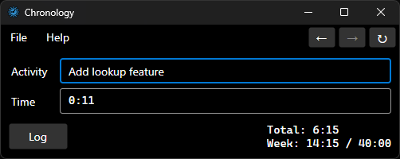

# Chronology

Desktop timekeeping app written with dotnet and Avalonia UI.

[Requires the .NET 8 runtime.](https://dotnet.microsoft.com/en-us/download/dotnet/8.0/runtime)



# Features

- Autoincrements time
- Allows logging partial time e.g. clock says 1:20, you log 1:00, it leaves the remainder 0:20 for the next task
- Supports time expressions e.g. `1:20-0:30`
- Copes with manual edits to the log files, refreshing immediately
- Activity history to easily recall recurring tasks
- Logs to markdown for readability and easy parsing
- Configurable reminder interval with custom sounds
- Configurable weekly goal with a running total
- Cross-platform (Windows, Mac, Linux)

# Log formats

Entries are written to one file per day, in the format selected by `store.type`.

## `Plaintext` (default) - `2026-10-30.txt`

```text
# Chronology log - 2026-10-30

| Time  | Activity                                                                         | Duration |
| ----- | -------------------------------------------------------------------------------- | -------- |
| 09:00 | Fix login bug                                                                    | 0:48     |
| 10:15 | Code review                                                                      | 0:30     |
| 11:00 | Team standup                                                                     | 0:25     |
| 13:30 | Add lookup feature                                                               | 1:15     |

# Total: 2:58
```

## `Legacy` - `TimeLog.20261030.txt`

```text
Time   Project                Activity Description (2026-10-30)
-----  --------------------   ----------------------------------------------------------------------
 0:48  [GENERAL]              Fix login bug
 0:30  [GENERAL]              Code review
 0:25  [GENERAL]              Team standup
 1:15  [GENERAL]              Add lookup feature
-----  --------------------   ----------------------------------------------------------------------
 2:58  *TOTAL                 Total time spent on work related activities.
-----  --------------------   ----------------------------------------------------------------------
```

# Config

`config.json` lives in the application's working directory. Null properties are treated as unset and defaulted.

<!-- configdocgen:start -->

| Key                           | Type                                                                                     | Default     | Notes                                                                    |
| ----------------------------- | ---------------------------------------------------------------------------------------- | ----------- | ------------------------------------------------------------------------ |
| `version`                     | int                                                                                      | `1`         | Config schema version, do not edit.                                      |
| `reminder.enabled`            | bool                                                                                     | `false`     | Plays audio alert when application has been idle for the specified time. |
| `reminder.count`              | int                                                                                      | `1`         | Must be > 0.                                                             |
| `reminder.intervalMinutes`    | double                                                                                   | `30`        | Must be > 0.                                                             |
| `reminder.soundFile`          | string                                                                                   | `null`      | `.wav` file; `null` = system sound. File must exist.                     |
| `weeklySum.enabled`           | bool                                                                                     | `false`     | Show the weekly counter under Total.                                     |
| `weeklySum.goalHighlightShow` | bool                                                                                     | `true`      | Highlight the weekly sum when the goal is met.                           |
| `weeklySum.goalHours`         | double                                                                                   | `40`        | Must be > 0.                                                             |
| `weeklySum.goalShow`          | bool                                                                                     | `true`      | Show the `/ goal` suffix.                                                |
| `weeklySum.weekStart`         | `Sunday` \| `Monday` \| `Tuesday` \| `Wednesday` \| `Thursday` \| `Friday` \| `Saturday` | `Sunday`    |                                                                          |
| `store.type`                  | `Legacy` \| `Plaintext`                                                                  | `Plaintext` |                                                                          |

## `Legacy` store

| Key                    | Type                   | Default     | Notes                                                 |
| ---------------------- | ---------------------- | ----------- | ----------------------------------------------------- |
| `store.dataDirectory`  | string                 | `./timelog` | Relative paths resolve against the working directory. |
| `store.durationFormat` | `Hhmm` \| `Fractional` | `Hhmm`      | Duration format in files - `9:30` vs `9.50`.          |

## `Plaintext` store

| Key                   | Type   | Default     | Notes                                                 |
| --------------------- | ------ | ----------- | ----------------------------------------------------- |
| `store.dataDirectory` | string | `./timelog` | Relative paths resolve against the working directory. |

<!-- configdocgen:end -->
